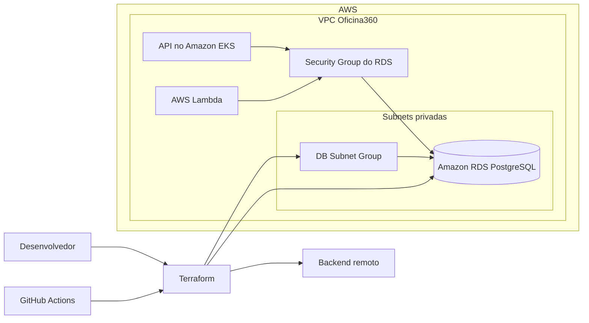

# Oficina360 - Infraestrutura de Banco de Dados

Infraestrutura como código responsável pelo banco de dados da **Oficina360**, desenvolvida para a Fase 3 do Tech Challenge.

## 1. Propósito do repositório

Este repositório provisiona e mantém o banco **PostgreSQL gerenciado pelo Amazon RDS** utilizado pela Oficina360.

As principais responsabilidades são:

- provisionar a instância PostgreSQL no Amazon RDS;
- configurar o DB Subnet Group;
- integrar o banco à VPC e às subnets da plataforma;
- configurar parâmetros e variáveis do banco;
- manter o estado remoto do Terraform;
- disponibilizar PostgreSQL local com Docker Compose;
- executar validação, deploy e destruição por GitHub Actions.

Este repositório não contém o código da API, da Lambda ou do cluster Kubernetes. Esses componentes são mantidos em repositórios separados.

## 2. Tecnologias utilizadas

- AWS
- Amazon RDS for PostgreSQL
- Amazon VPC
- Terraform
- AWS Provider for Terraform
- Docker
- Docker Compose
- GitHub Actions
- Bash

## 3. Arquitetura específica do repositório



### Componentes

- **Terraform:** descreve e mantém a infraestrutura do banco.
- **Backend remoto:** armazena o estado compartilhado do Terraform.
- **DB Subnet Group:** define as subnets utilizadas pelo RDS.
- **Security Group:** limita o acesso à porta PostgreSQL às origens autorizadas.
- **Amazon RDS:** executa o PostgreSQL gerenciado utilizado pela API e pela autenticação.
- **Docker Compose:** disponibiliza PostgreSQL apenas para desenvolvimento local.

## 4. Estrutura do repositório

```text
.
├── .github/
│   └── workflows/
│       ├── terraform.yml
│       └── teste.yml
├── docker/
│   ├── .env
│   ├── docker-compose.yml
│   └── teste.md
├── docs/
│   └── rodar-local.md
├── infra/
│   ├── .terraform.lock.hcl
│   ├── backend.tf
│   ├── locals.tf
│   ├── outputs.tf
│   ├── parameters.tf
│   ├── provider.tf
│   ├── rds.tf
│   ├── subnet-group.tf
│   ├── variables.tf
│   └── versions.tf
├── scripts/
│   ├── bootstrap-state.sh
│   └── resolve-database-network.sh
├── .gitignore
└── README.md
```

> Os diretórios `.terraform/` e `.idea/`, além do arquivo `docker/.env`, não devem ser versionados. O arquivo `.terraform.lock.hcl` deve permanecer no repositório.

## 5. Pré-requisitos

### Ferramentas

- Terraform
- AWS CLI
- Docker
- Docker Compose
- Bash
- Git

### Credenciais e configurações

Configure os Secrets do GitHub utilizados pelos workflows:

```text
AWS_ACCESS_KEY_ID
AWS_SECRET_ACCESS_KEY
AWS_SESSION_TOKEN
DB_USERNAME
DB_PASSWORD
```

Configure também a variável do repositório:

```text
AWS_REGION=us-east-1
```

Os nomes devem corresponder aos utilizados nos arquivos de `.github/workflows/` e nas variáveis Terraform.

## 6. Execução local

O ambiente local utiliza Docker Compose e não depende do Amazon RDS.

Consulte também [`docs/rodar-local.md`](docs/rodar-local.md).

### 6.1 Criar o arquivo de ambiente

Crie `docker/.env` com valores exclusivamente locais:

```dotenv
POSTGRES_DB=oficina360
POSTGRES_USER=oficina360_local
POSTGRES_PASSWORD=altere-esta-senha
POSTGRES_PORT=5432
```

Não envie esse arquivo ao Git.

### 6.2 Iniciar o banco local

```bash
cd docker
docker compose up --detach
```

### 6.3 Verificar o container

```bash
docker compose ps
```

### 6.4 Acompanhar os logs

```bash
docker compose logs --follow
```

### 6.5 Encerrar

```bash
docker compose down
```

Para remover também os dados locais:

```bash
docker compose down --volumes
```

## 7. Deploy da infraestrutura

### 7.1 Preparar o backend remoto

Na raiz do repositório:

```bash
bash scripts/bootstrap-state.sh
```

### 7.2 Resolver a rede do banco

```bash
bash scripts/resolve-database-network.sh
```

### 7.3 Inicializar o Terraform

```bash
cd infra
terraform init
```

### 7.4 Validar

```bash
terraform fmt -check -recursive
terraform validate
```

### 7.5 Gerar e revisar o plano

```bash
terraform plan -out=tfplan
terraform show tfplan
```

### 7.6 Aplicar

```bash
terraform apply tfplan
```

### Deploy pelo GitHub Actions

1. Acesse **Actions** no GitHub.
2. Selecione o workflow definido em `.github/workflows/terraform.yml`.
3. Escolha a ação de validação ou deploy disponível no workflow.
4. Execute **Run workflow**.
5. Aguarde a conclusão dos passos de `init`, `validate`, `plan` e `apply`.
6. Consulte os logs e artifacts da execução em caso de falha.

## 8. Validação do deploy

### Consultar o RDS

```bash
aws rds describe-db-instances \
  --region "${AWS_REGION:-us-east-1}" \
  --query 'DBInstances[].{Identifier:DBInstanceIdentifier,Engine:Engine,Status:DBInstanceStatus,Endpoint:Endpoint.Address,Port:Endpoint.Port}' \
  --output table
```

### Consultar os outputs

```bash
cd infra
terraform output
```

### Testar uma conexão autorizada

Execute somente a partir de uma origem permitida pelo Security Group:

```bash
psql \
  --host "$DB_HOST" \
  --port "${DB_PORT:-5432}" \
  --username "$DB_USERNAME" \
  --dbname "$DB_NAME"
```

Não inclua a senha diretamente no comando.

## 9. Destruição

Antes da destruição, confirme se existe snapshot ou backup válido e se os dados podem ser removidos.

```bash
cd infra
terraform plan -destroy -out=destroy.tfplan
terraform show destroy.tfplan
terraform apply destroy.tfplan
```

> A destruição do Amazon RDS pode causar perda permanente de dados.

## 10. Swagger e Postman

Este repositório provisiona somente o banco de dados e, portanto, **não expõe endpoints HTTP nem possui Swagger próprio**.

A documentação e a collection das APIs da Oficina360 ficam no repositório da aplicação principal.

## 11. Segurança

- Não versione `docker/.env`.
- Não versione `infra/.terraform/`.
- Não versione `.idea/`.
- Não publique usuário ou senha do banco.
- Utilize GitHub Secrets para valores sensíveis.
- Restrinja o Security Group do RDS às origens necessárias.
- Evite configurar o RDS como publicamente acessível.
- Proteja a branch `main` e utilize Pull Requests.
- Revogue imediatamente qualquer credencial exposta.

## 12. Repositórios relacionados

- Aplicação principal: `https://github.com/pos-fiap-michaelhion/tech_challenge_pos_arquitetura_de_software.git`
- Lambda de autenticação: `https://github.com/pos-fiap-michaelhion/tc_fiap_oficina360_auth_lambda.git`
- Infraestrutura Kubernetes: `https://github.com/pos-fiap-michaelhion/tc_fiap_oficina360_k8s_infra.git`
- Infraestrutura do banco: `https://github.com/pos-fiap-michaelhion/tc_fiap_oficina360_database_infra.git`
